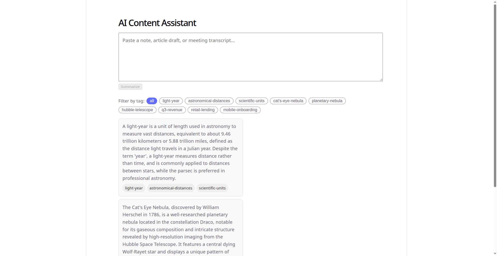
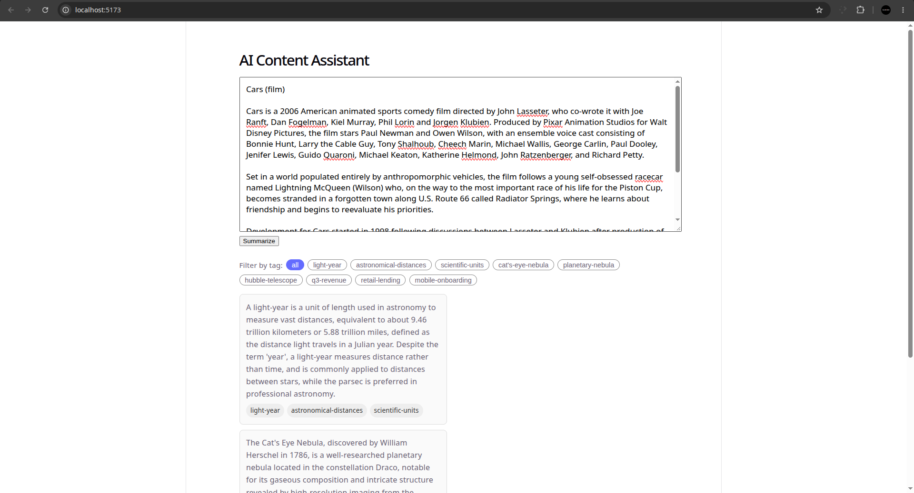
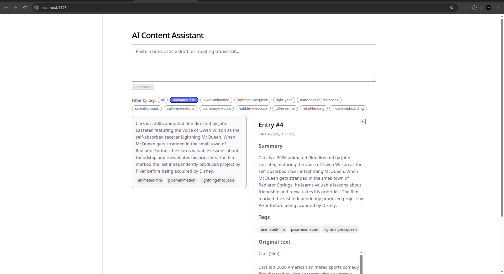

# AI Content Assistant

A small full stack prototype. A user pastes a block of text (a note, an article draft, a meeting transcript), the app calls an LLM to generate a concise summary and exactly three tags, and the result is stored and browsable.

Built for the IIFL Finance Full Stack and Applied AI Round 1 assignment.

## Stack

- **Backend:** Python, FastAPI, SQLAlchemy, SQLite
- **AI:** OpenAI API (`gpt-4o-mini`), called with a JSON schema structured output (`response_format: json_schema`) so the model's response is constrained to a predictable shape instead of being parsed out of free text
- **Frontend:** React (Vite), plain CSS, no component library

## Setup

### Backend

```bash
cd backend
python3 -m venv .venv && source .venv/bin/activate
pip install -r requirements.txt
cp .env.example .env   # fill in OPENAI_API_KEY
uvicorn app.main:app --reload --port 8000
```

Run the automated tests:

```bash
pytest tests/ -v
```

### Frontend

```bash
cd frontend
npm install
cp .env.example .env   # defaults to http://localhost:8000, change if your backend runs on a different port
npm run dev
```

Open http://localhost:5173, paste some text, and submit. Click an entry in the list to open the detail view with the original text, summary, and tags. Click a tag pill to filter the list down to entries that share that tag.

### Screenshots

**Home, list, and tag filter.** Saved entries on the left, tag pills above them, detail view opens on the right when an entry is clicked.



**Submitting a new entry.** Long text pasted into the form, about to click Summarize.



**Result.** The new entry is saved with a summary and exactly three tags (`light-year`, `astronomical-distances`, `scientific-units`), the tag filter is applied, and a previously saved entry is open in detail view on the right.



### Inspecting the database

The database is a single file, `backend/entries.db`, created automatically the first time the backend starts. To look inside it directly:

```bash
sqlite3 backend/entries.db
.tables
.schema entries
SELECT id, summary, tags, status, created_at FROM entries;
```

### Testing the API directly

A Postman collection is included at the project root: `postman_collection.json`. Import it into Postman, it covers the happy path (create, list, filter by tag, get by id) as well as the validation and failure cases (empty text, missing field, over the length limit, unknown id), each with built in assertions so you get pass or fail results instead of having to read raw JSON every time.

## API

- `POST /entries`, body `{ "text": "..." }`. Validates the input, calls the LLM, persists the entry, and returns it. If the AI call fails for any reason, the backend still saves a `status: "failed"` entry with an error message and responds with `502`, rather than losing the submission.
- `GET /entries`, optional `?tag=` query parameter to filter.
- `GET /entries/{id}`, fetch a single entry.

## Judgment questions

**1. Architecture.** The React frontend sends a `POST /entries` request with the raw text to the FastAPI backend. The backend validates the request with Pydantic, calls the OpenAI Chat Completions API with a JSON schema constrained response format, parses and validates that response into `{summary, tags}` (exactly three tags), and writes one row (original text, summary, tags as a JSON string, status) to SQLite through SQLAlchemy. The frontend then re-fetches `GET /entries` to refresh the list. Opening the detail view does not need a second network call, since the list response already contains the full entry data.

**2. AI choice.** OpenAI's `gpt-4o-mini`, through the official `openai` Python SDK, chosen because it is cheap and fast enough for a synchronous summarize-and-tag call while still reliable at following a structured output schema. The entire call is isolated behind one function, `generate_summary_and_tags(text) -> AIOutput`, in `app/llm.py`. Nothing else in the codebase knows which provider sits behind that function, which is what made it straightforward to switch this project from Claude to OpenAI mid build without touching the API routes, the database layer, or the frontend at all.

**3. Reliability.** The OpenAI client has a twenty second timeout. Timeout errors, API status errors (rate limits, server errors), and connection errors are all caught and converted into one internal `AIGenerationError`. If the model returns something that is not valid JSON, or valid JSON that does not match the expected `{summary, tags}` shape, or does not contain exactly three tags, that is caught the same way. In every one of these failure cases the backend still writes a `status: "failed"` row with the original text and a human readable error message, instead of silently dropping the user's submission, and returns a `502` so the frontend can show an inline error instead of crashing.

**4. Privacy.** Right now the full raw text a user pastes is sent to OpenAI exactly as typed, nothing is stripped or masked first. In a financial services setting I would not want to send things like account numbers, PAN or Aadhaar or other government identifiers, or any customer identity tied to a financial detail, if they are not actually needed to produce a summary and tags. The real fix before production is a redaction or tokenization pass (regex based at minimum, a lightweight NER model for anything fuzzier) that runs on the text before it ever leaves the backend, plus confirming the provider's data retention and model training opt out settings are configured correctly for the workspace.

**5. Production next steps (top three).**
- Add PII redaction before the text reaches the LLM, and lock down data retention settings with the provider.
- Normalize tags out of the current JSON text column into a proper `tags` table plus a join table, and add pagination to `GET /entries` so the list does not grow unbounded.
- Add structured retries with backoff and a visible retry action in the UI for failed entries, instead of forcing the user to resubmit the entire text from scratch.

**6. AI coding tools.** Built with Claude Code. I reviewed the generated validation and parsing logic by hand, ran the automated test suite after every change, and manually exercised the API with both mocked and real LLM calls (including a live OpenAI request, not just the mocked tests) before considering the backend done, rather than trusting generated code without actually running it.

## Future scope

A few things I deliberately left out of this submission because the assignment explicitly scopes them out, but would be worth raising in a follow up conversation about taking this to production:

- **Provider abstraction.** The current design swaps providers by rewriting one file, which is good enough for a single provider in use at a time, but a real multi-provider setup (for example, fallback to a second provider if the primary is down or rate limited) would want a small interface (`summarize(text) -> AIOutput`) with one implementation per provider, selected by configuration.
- **Normalized tags.** Tags are stored as a JSON string on each entry right now. That is the right call for a three hour prototype, but at real scale, with tag based filtering, autocomplete, or analytics on tag frequency, a normalized `tags` and `entry_tags` table pays for itself.
- **Background processing.** The LLM call currently happens synchronously inside the request, so a slow model response makes the user wait. A production version would likely queue the job, return immediately with a pending status, and let the frontend poll or use a websocket for the result.
- **Observability.** No logging/metrics pipeline beyond basic Python logging right now. In production I would want request tracing, LLM latency and token usage metrics, and alerting on the failure rate of the AI call specifically, since that is the component most likely to degrade independently of the rest of the app.
- **Auth and multi-tenancy.** Out of scope for this assignment, but a real version would need to scope entries to a logged in user or workspace rather than being a single shared list.
